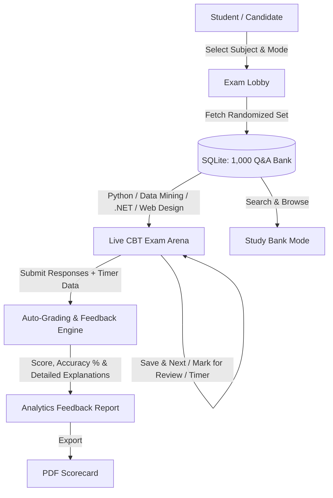

<div align="center">

<!-- Animated product banner (local GIF, committed with the repo) -->


<br>

<!-- Typing-style animated headline -->


<br>


**Enterprise Mock Exam & Practice Test Platform**
[github.com/Rg100152/exampulse](https://github.com/Rg100152/exampulse) · Developed by **Raj Gautam**

</div>

<div align="center">

</div>

## 🎬 Live product preview

<div align="center">


*From the live CBT arena → question palette → detailed analytics report*

</div>

<div align="center">

</div>

## ⚡ What it does

ExamPulse 1000 is a full-stack, offline-friendly mock test engine. It stores **1,000 curated MCQs**
in modular JSON banks, indexes them into SQLite for instant loading even on a 4 GB RAM machine,
and delivers an NTA/TCS-iON inspired computer-based-test experience with a forensic result report.

| | Feature | Details |
|:---:|:---|:---|
| 🧠 | **1,000 questions** | 4 tracks × 250 MCQs, each with 4 options, difficulty, topic and a detailed explanation |
| ⏱️ | **Pro CBT arena** | Split-screen layout, live countdown, color-coded palette, Save & Next, Mark for Review, Clear, auto-submit |
| 📊 | **Analytics report** | Score, accuracy, negative-mark breakdown, topic-wise weak areas, full solution walkthrough with filters |
| 📚 | **Study Bank mode** | Search and browse all 1,000 Q&As with explanations visible |
| 📄 | **PDF scorecard** | Dependency-free, print-ready A4 report download |
| ⚡ | **Fast & light** | Indexed SQLite queries; 250-question page loads in ~15–30 ms |

Marking scheme: **+1** correct · **−0.25** wrong · **0** unanswered.

<div align="center">

</div>

## 🗺️ Data Flow Diagram (DFD)



<div align="center">

</div>

## 📚 Question bank distribution

| Subject Track | Total | Key Topics Covered |
| :--- | :---: | :--- |
| 🐍 **Python Programming** | 250 | Core syntax, data structures, OOP, functions, generators, decorators, files, exceptions, libraries, advanced concepts |
| ⛏️ **Data Mining & Warehousing** | 250 | KDD, preprocessing, Apriori, decision trees, K-means, OLAP, star schema, evaluation metrics, text mining, big data |
| 💠 **.NET Framework & C#** | 250 | CLR, CTS, C# fundamentals, OOP, LINQ, ASP.NET Core, Entity Framework, memory, exceptions, async/await |
| 🌐 **Web Design & Frontend** | 250 | Semantic HTML5, CSS Grid/Flexbox, responsive UI, JavaScript ES6, DOM events, UI/UX, accessibility, performance |

```text
Easy    400  ████████████████████  40.0%
Medium  402  ████████████████████  40.2%
Hard    198  ██████████           19.8%  (≈20% in every track)
```

<div align="center">

</div>

## 🚀 Quick start

```bash
git clone https://github.com/Rg100152/exampulse.git
cd exampulse

python3 -m venv venv
source venv/bin/activate          # Windows: venv\Scripts\activate
pip install -r requirements.txt

python seed_1000_questions.py     # builds database/exampulse.db from data/*.json
python app.py                     # http://127.0.0.1:5000
```

The database is created automatically on first run if the four JSON banks are present.

<details>
<summary><b>🔧 Regenerate & verify the question banks</b></summary>

```bash
python utils/generate_readme_assets.py  # refresh the animated README GIFs
python generate_question_banks.py       # validate generators/ and write data/*.json
python verify_banks.py                  # final integrity report: 1,000 unique, complete questions
python seed_1000_questions.py --check   # validate JSON without touching SQLite
python seed_1000_questions.py --force   # wipe and re-index all 1,000 questions
```

Optional environment variables: `EXAMPULSE_DB`, `EXAMPULSE_SECRET`, `EXAMPULSE_HOST`,
`EXAMPULSE_PORT`, `EXAMPULSE_DEBUG`, `EXAMPULSE_CANDIDATE`.

</details>

<div align="center">

</div>

## 🧩 Project structure

<details>
<summary><b>Click to expand the full tree</b></summary>

```text
exampulse/
├── app.py                      # Flask server & app factory
├── exampulse_core.py           # Config, SQLite access, attempt creation, grading
├── generate_question_banks.py  # Validates generators/ and writes data/*.json
├── verify_banks.py             # Final 1,000-question integrity report
├── seed_1000_questions.py      # Indexes all 1,000 Q&As into SQLite
├── requirements.txt
├── README.md
├── LICENSE
├── .gitignore
├── generators/                 # Offline question authoring modules + bank contract
├── data/
│   ├── python_250.json
│   ├── datamining_250.json
│   ├── dotnet_250.json
│   └── webdesign_250.json
├── database/
│   └── exampulse.db            # Generated: questions + attempts + responses
├── routes/
│   ├── exam_routes.py          # Lobby, CBT arena, report, study bank, PDF export
│   └── api_routes.py           # JSON APIs for question sets and grading
├── templates/
│   ├── base.html
│   ├── index.html
│   ├── exam_arena.html
│   ├── feedback_report.html
│   ├── bank_viewer.html
│   ├── results.html
│   └── not_found.html
├── static/
│   ├── css/cbt_ui.css
│   ├── js/examEngine.js
│   ├── js/analytics.js
│   └── assets/
│       ├── logo-exampulse.svg
│       ├── exampulse-banner.gif       ← animated banner
│       ├── typing-exampulse.gif       ← animated typing headline
│       ├── cbt-demo.gif               ← animated product demo
│       └── pulse-divider.gif          ← animated section divider
└── utils/
    ├── pdf_scorecard.py        # Pure-stdlib PDF generation
    └── generate_readme_assets.py # Rebuilds the animated GIFs
```

</details>

<div align="center">

</div>

## 🔌 Routes & API

| Method | Endpoint | Purpose |
| :--- | :--- | :--- |
| GET | `/` | Exam lobby with 4 subject tracks |
| GET | `/exam/<subject>?mode=quick\|mock\|full` | Live CBT arena |
| GET | `/result/<attempt_code>` | Detailed analytics report |
| GET | `/result/<attempt_code>/pdf` | Download PDF scorecard |
| GET | `/bank/<subject>` | Study bank with search and filters |
| GET | `/results` | Attempt history |
| GET | `/api/subjects` | Subject metadata and question counts |
| GET | `/api/stats` | Overall platform statistics |
| GET | `/api/questions/<subject>` | Searchable question set (`q`, `topic`, `difficulty`, `limit`, `offset`) |
| POST | `/api/attempts/start` | Create randomized attempt (`subject`, `mode`) |
| GET | `/api/attempts/<code>` | Live attempt payload (answers withheld) |
| POST | `/api/attempts/<code>/submit` | Server-authoritative grading |
| GET | `/api/attempts/<code>/report` | Full JSON report |
| GET | `/api/health` | Health check |

```bash
curl -X POST http://127.0.0.1:5000/api/attempts/start \
  -H 'Content-Type: application/json' \
  -d '{"subject":"python","mode":"quick"}'
```

<div align="center">

</div>

## 🎨 Design tokens

| Role | Color | Swatch |
| :--- | :--- | :--- |
| Background | `#F1F5F9` cool slate |  |
| Header & palette | `#0F172A` deep navy |  |
| Answered | `#10B981` emerald |  |
| Marked for review | `#8B5CF6` royal purple |  |
| Not answered | `#EF4444` coral red |  |
| Current question | `#2563EB` electric blue |  |

<div align="center">

</div>

## ✅ Integrity & performance

- `question_key` is a SHA-1 of subject + normalized question text with a UNIQUE constraint — duplicates cannot be seeded.
- The seeder validates schema, option count, distinct options, answer letter, topic vocabulary, difficulty and explanation length before any insert.
- Questions are fetched with indexed, server-side pagination, so all 1,000 Q&As never load into the browser at once.
- Grading reads correct answers from SQLite only — client-side answer data can never alter the score.
- Verified end-to-end: lobby → 250-Q arena → submit → analytics → PDF (valid A4, 8 pages).

---

<div align="center">

**Built with Flask + SQLite + HTML5 + CSS3 + Vanilla JS — no frontend framework, no paid services.**

© 2026 Raj Gautam · MIT License


</div>
